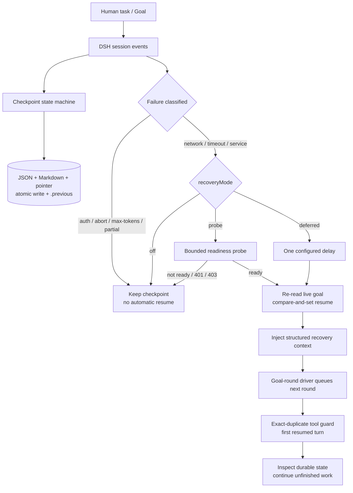

# dsh-task-checkpoint-guard

**Durable task checkpoints and safe, bounded recovery for DeepSeek Harness agents.**

English | [简体中文](README.zh-CN.md) | [GitHub repository](https://github.com/jlnkx5200-beep/dsh-task-checkpoint-guard)

> **Status: v0.2.0 (2026-11-04).** Developed and tested against **DSH 0.2.1-rc.3** on Windows 11 with Node.js 24.21.0. The package declares the accepted DSH range in `engines.dsh`; other versions are not claimed as tested. The optional memory subsystem is **off by default** and does not change v0.1.0 checkpoint/recovery behavior. Released under the [MIT License](LICENSE).

DSH agents can lose the thread when a long-running task is interrupted by a network failure, a provider timeout, a 5xx service error, or a process restart. The conversation log preserves history, but a restarted agent still needs a compact, structured account of what it was doing: the objective, current step, completed tools, uncertain tool outcomes, todos, and the last visible results.

`dsh-task-checkpoint-guard` records that account locally, classifies recoverable transport failures, optionally waits for a bounded readiness probe, and re-arms an existing DSH goal only when it is safe to continue. It never saves hidden chain-of-thought and never uploads task records.

v0.2.0 adds an **optional hierarchical memory curator**: it can separate L0 goals and constraints from L1 core questions/concepts, L2 prerequisites, and L3 details; maintain a concept dependency graph; and inject a bounded, prerequisite-aware context before explanations. The feature defaults to `memoryEnabled: false`. When disabled, no memory tools or prompt sections are registered and the v0.1.0 checkpoint schema and recovery behavior remain unchanged.

## What it does

- Persists a structured checkpoint for every live DSH session as **JSON + Markdown + a session pointer**.
- Captures the original human instruction, goal objective/revision, todos, turn/step position, tool lifecycle, and bounded visible results.
- Excludes model reasoning text; it stores only reasoning block/character counts.
- Redacts credential-shaped strings and secret-looking JSON fields before writing.
- Writes checkpoint files with a same-directory temporary file, `fsync`, and rename; retains `<file>.previous` as the previous valid copy.
- Classifies `NETWORK`, `TIMEOUT`, `SERVICE`, `AUTH_OR_REQUEST`, `ABORTED`, and `UNKNOWN` failures.
- Applies a fail-closed recovery policy:
  - no automatic recovery after user cancellation, auth/request errors, max-token stops, or partial streams;
  - no automatic recovery while a tool call has no durable result;
  - no blind retry of a tool call that already completed or ended with an unknown outcome.
- Supports three recovery modes:
  - `off` — checkpoint only (default);
  - `probe` — bounded HTTP(S) readiness probe before re-arming the goal;
  - `deferred` — explicit opt-in delay without an outbound probe.
- Re-arms an active, disarmed DSH goal with a compare-and-set revision check, then injects one structured context message.
- Optionally denies exact duplicate tool calls **during the first resumed turn**, after which the guard clears automatically.
- Reconciles missing session events through the public `ctx.sessionQuery` service when it is available.

### Optional hierarchical memory (v0.2.0)

When explicitly enabled:

- Captures genuine human messages into independent records without making a
  model call per session event.
- Classifies each item into L0/L1/L2/L3 and tracks priority, feasibility, and
  confidence separately.
- Keeps L0/L1 authority over lower-layer detail; corrections retain history and
  same-layer contradictions become explicit conflicts.
- Maintains a directed concept graph with multiple prerequisites, cycle
  detection, unresolved dependencies, user order, and dynamic explanation order.
- Enforces a Concept Prerequisite Guard: an unexplained concept cannot be used
  as a default premise, and only explicit user evidence can mark a concept
  `VERIFIED`.
- Retrieves L0/L1/L2 before L3 under a character/token budget and exposes
  omitted detail through explicit search.
- Registers `memory_capture`, `memory_search`, `concept_graph`,
  `concept_status`, `memory_update`, and `memory_delete` when the public tool
  registry is present.
- Stores memory in a separate schema/document and atomic file from checkpoints.

See [the v0.2.0 design](docs/design-v0.2.0.md) and
[testing status](docs/testing.md).

## What it deliberately does not do

- It does **not** save or reconstruct hidden chain-of-thought. Recovery uses visible messages, durable execution facts, and structured state only.
- It does **not** upload, sync, or share checkpoints. The only outbound request is an optional readiness probe to a user-configured HTTPS/HTTP endpoint.
- It does **not** guarantee tool-call idempotency. The duplicate guard covers exact repeated fingerprints during the first resumed turn; different calls with the same side effect remain the model's responsibility.
- It does **not** start a model round by itself. Automatic continuation requires DSH's goal service **and** goal-round driver. Without the driver, the goal is re-armed and context is queued, but no new turn may start.
- The optional memory guard is code-backed at the state-transition and context
  layers, but it is **not** a token-level interception of free-form model text.
  It can deny state transitions and audit observed violations; it cannot prove
  that every model answer follows the guard.
- It does **not** make an unverified model-inference upgrade to user fact or
  `VERIFIED` state.
- It does **not** claim statistically validated explanation-quality
  improvement. The semantic fixtures and opt-in real-model pilot protocol are
  separate from the deterministic test suite.
- It does **not** promise compatibility with every DSH release. See [Compatibility](#compatibility).

## How it works



The checkpoint writer and recovery loop are serialized per session. Recovery rechecks agent liveness, idle state, pending inbox, goal revision, goal phase, activation, and round budget immediately before resuming. If a human message arrives, the in-flight readiness wait is aborted and the plugin does not resume.

See [docs/architecture.md](docs/architecture.md) for the full lifecycle and event/API details.

## Requirements

- **Node.js:** `^22.19.0` or `>=24.0.0` (the DSH runtime range declared by DSH 0.2.1-rc.3).
- **DSH:** see `engines.dsh` in [package.json](package.json). Locally tested with `0.2.1-rc.3`.
- Required host services: `agents`, `sessions`.
- Optional host capabilities:
  - `goals` + `goal-round-driver` for automatic goal continuation;
  - `credentials` for authenticated probes;
  - `sessionQuery` for replaying events that happened before the plugin mounted or between a stale checkpoint and the live log;
  - `tools` and `systemPrompt` for the opt-in v0.2.0 memory tools and curated prompt section. If either registry is absent, checkpointing/recovery still loads and memory tools/context degrade to unavailable; `memoryEnabled` remains off by default.
- No npm runtime dependencies.

## Install

Build the release tarball from this repository:

```sh
npm pack
```

Install it into the DSH profile you actually use:

```sh
dsh plugin --profile <profile> add ./dsh-task-checkpoint-guard-0.2.0.tgz
```

For a source checkout, install the directory directly:

```sh
dsh plugin --profile <profile> add ./dsh-task-checkpoint-guard
```

Confirm the composed profile contains the bundle row:

```sh
dsh --profile <profile> --dump-config
```

Start the profile normally (for the standard Web profile, `dsh web` is also valid):

```sh
dsh --profile <profile>
```

The default checkpoint directory is `$DSH_HOME/task-checkpoints` (or `%USERPROFILE%\.dsh\task-checkpoints` when `DSH_HOME` is not set).

### Verify

After a task has run, inspect the local files:

```powershell
Get-ChildItem "$HOME\.dsh\task-checkpoints" -Recurse
Get-Content "$HOME\.dsh\task-checkpoints\tasks\<task-id>.md"
```

On POSIX shells:

```sh
find "${DSH_HOME:-$HOME/.dsh}/task-checkpoints" -maxdepth 3 -type f
```

### Uninstall

```sh
dsh plugin --profile <profile> remove dsh-task-checkpoint-guard
```

Uninstalling the plugin does not delete checkpoint files. Remove the checkpoint directory manually only when you no longer need the records.

## Configuration

The bundle starts with safe defaults: `recoveryMode: off`, local checkpointing enabled, and the exact-duplicate guard limited to a resumed turn. To override the bundle row, edit the profile's `cordis.patch.yml` and restate the complete configuration you want (a later patch replaces the whole row config):

```yaml
- id: task-checkpoint-guard
  name: dsh-task-checkpoint-guard
  config:
    checkpointRoot: ~/.dsh/task-checkpoints
    recoveryMode: probe
    probeUrl: https://api.example.test/v1/models
    probeMethod: GET
    probeAuth: bearer
    credentialRef: EXAMPLE_API_KEY
    probeExpectedStatuses: [200]
    probeTimeoutMs: 5000
    maxProbeAttempts: 5
    initialProbeDelayMs: 1000
    maxProbeDelayMs: 30000
    jitterRatio: 0.2
    maxAutoResumes: 3
    providerFilter: null
    duplicateToolPolicy: deny-on-recovery
    maxToolHistory: 80
    maxToolResultChars: 2000
    maxToolArgumentChars: 1000
    maxRecoveryContextChars: 16000
    persistDebounceMs: 100
    reconstructFromSessionQuery: true
    memoryEnabled: false
    memoryScopeId: default-user
    maxMemoryRecords: 500
    maxMemoryConcepts: 300
    maxMemoryHistoryVersions: 20
    maxMemoryAuditEntries: 200
    maxMemoryRecordChars: 2000
    maxMemoryContextChars: 6000
    maxMemoryContextTokens: 1200
```

`https://api.example.test` and `EXAMPLE_API_KEY` are placeholders. Use the readiness endpoint and credential reference that match your deployment. A credential reference names a secret held by DSH's credentials service; the value is never written to a checkpoint.

Full parameter semantics and security notes: [docs/configuration.md](docs/configuration.md).

### Optional hierarchical memory example

```yaml
- id: task-checkpoint-guard
  name: dsh-task-checkpoint-guard
  config:
    recoveryMode: off
    memoryEnabled: true
    memoryRoot: ~/.dsh/task-memory
    memoryScopeId: default-user
    maxMemoryRecords: 500
    maxMemoryConcepts: 300
    maxMemoryContextChars: 6000
    maxMemoryContextTokens: 1200
```

Adding `memoryRoot` while `memoryEnabled` is false is rejected rather than
silently ignored. Memory files are not checkpoint files and are not required
for v0.1.0 recovery.

### Minimal safe examples

Checkpoint only:

```yaml
- id: task-checkpoint-guard
  name: dsh-task-checkpoint-guard
  config:
    recoveryMode: off
```

Automatic recovery with a readiness probe:

```yaml
- id: task-checkpoint-guard
  name: dsh-task-checkpoint-guard
  config:
    recoveryMode: probe
    probeUrl: https://your-provider.example/v1/models
    probeAuth: bearer
    credentialRef: YOUR_PROVIDER_API_KEY
    providerFilter: your-provider
    duplicateToolPolicy: deny-on-recovery
```

Deferred recovery (explicitly allows an automatic model retry after a delay without proving connectivity):

```yaml
- id: task-checkpoint-guard
  name: dsh-task-checkpoint-guard
  config:
    recoveryMode: deferred
    initialProbeDelayMs: 5000
    maxAutoResumes: 1
```

## Demonstration: a non-destructive multi-stage task

This example uses a scratch directory and only reads or creates harmless local files.

1. Start a DSH session in a scratch directory.
2. Give the agent a goal such as:

   ```text
   Create ./checkpoint-demo/stages/a.txt, then ./checkpoint-demo/stages/b.txt.
   Verify both files and summarize their contents. Do not touch anything outside
   ./checkpoint-demo.
   ```

3. The agent may call `todo_write`, create the directory, and write the files. Each turn/tool event updates a checkpoint under `$DSH_HOME/task-checkpoints`.
4. Inspect the Markdown checkpoint. It contains the original objective, goal revision, todos, current step, completed tool calls, recent visible results, and the recovery policy. It does **not** contain reasoning text.
5. To exercise recovery safely, use a disposable DSH profile and a loopback probe endpoint. Do not intentionally break your normal provider credentials or network.
6. After recovery, the injected context tells the model which tool calls already completed, which outcomes are unknown, and which todo items remain. The first resumed turn refuses an exact replay of a completed tool call when `duplicateToolPolicy: deny-on-recovery`.

More troubleshooting: [docs/troubleshooting.md](docs/troubleshooting.md).

## Privacy and security

- Checkpoints are local-only and contain task text, bounded tool arguments/results, and session identifiers. Treat the checkpoint directory as sensitive user data.
- Optional memory documents are also local-only and may contain user goals, questions, concepts, correction history, and source references. They live under `memoryRoot` with the same sensitivity as session history.
- Credentials are resolved per probe from DSH's credentials service. They are sent only as an `Authorization` header to the configured probe endpoint and are never written to state or logs.
- Probe redirects are rejected; bearer probes require HTTPS unless the host is loopback.
- Common secret shapes and secret-looking JSON keys are redacted before persistence. Redaction is defense in depth, not a guarantee that arbitrary user text contains no secret. Do not put secrets in task prompts or tool arguments.
- File mode `0600` is requested for checkpoint files. On Windows, effective access is controlled by the directory ACL; protect `$DSH_HOME`.
- Multi-process writers to the same checkpoint root are not supported.
- Read [SECURITY.md](SECURITY.md) for the threat model and reporting guidance.

## Compatibility

| Surface | Status |
|---|---|
| DSH `0.2.1-rc.3` | Tested locally: Cordis loader smoke, public API integration tests, real `ToolRuntime` schema registration/execution, clean-profile install/uninstall smoke |
| Other DSH versions in `engines.dsh` | Accepted by the range but **not tested** |
| Memory curation | Deterministic tests A–L pass; real-model pilot completed (4 cases, baseline 1/4 vs guarded 4/4 under rubric v2); single-run pilot, not statistically validated |
| Node.js 24.21.0 on Windows 11 | Tested locally |
| Node.js 22.19 / other operating systems | CI matrix is configured; not yet claimed as locally verified |
| DSH private APIs / private plugin source | Not used. See [docs/architecture.md](docs/architecture.md#public-api-dependencies) |

Automatic continuation additionally depends on the host mounting `@deepseek-ai/dsh-goal` and `@deepseek-ai/dsh-goal-round-driver`. If the driver is absent, checkpoints and context injection still work, but a new model round may not be scheduled.

## Troubleshooting

Common cases:

- **No checkpoint files:** confirm the profile contains the bundle row and the plugin loaded; check `checkpointRoot` and permissions.
- **Recovery does not happen:** the default mode is `off`; verify `recoveryMode`, `probeUrl`, agent goal phase/activation, and pending-tool status.
- **Probe returns 401/403:** the host is reachable but credentials were rejected or unavailable; the plugin intentionally stops.
- **A tool call was denied:** it exactly matched a completed or unknown-outcome call during the first resumed turn. Inspect the recorded result or verify external state with a different operation.
- **Checkpoint is corrupt:** the loader tries `<file>.previous` and then a task-file scan. Preserve the directory for diagnostics.

Full guide: [docs/troubleshooting.md](docs/troubleshooting.md).

## Roadmap

Planned, not implemented:

- Per-provider readiness presets that do not hardcode any provider.
- Multi-agent and subagent task trees with parent/child checkpoint links.
- A visual checkpoint browser for inspecting and resuming tasks.
- Richer recovery policies for persistence failures and compaction boundaries.
- Checkpoint retention limits, cleanup commands, and encrypted-at-rest storage.
- Verified compatibility matrix across multiple released DSH versions.
- More precise tool idempotency metadata supplied by tool definitions.
- A statistically useful real-model semantic benchmark with multiple runs and blind review.
- Cross-process memory locking and optional encrypted-at-rest memory storage.
- Relation inference from a verified external knowledge source, never from keyword co-occurrence alone.

## Development

```sh
npm test
npm run check
npm run pack:check
npm run test:semantic:dry-run
```

The semantic dry run prints and saves the exact prompts for the real-model
pilot. Running `npm run test:semantic` requires public `DSH_EVAL_*` API
credentials and is never part of plugin startup. See
[docs/semantic-acceptance.md](docs/semantic-acceptance.md) for the rubric and
claim boundary.

To run the optional real-loader smoke test, point `DSH_CHECKOUT` at a DSH source checkout:

```powershell
$env:DSH_CHECKOUT = (Resolve-Path '..\deepseek-harness').Path
npm test
```

See [CONTRIBUTING.md](CONTRIBUTING.md).

## License

This project is released under the **MIT License**. Copyright (c) 2026 jlnkx5200-beep. See [LICENSE](LICENSE) for the full text.
