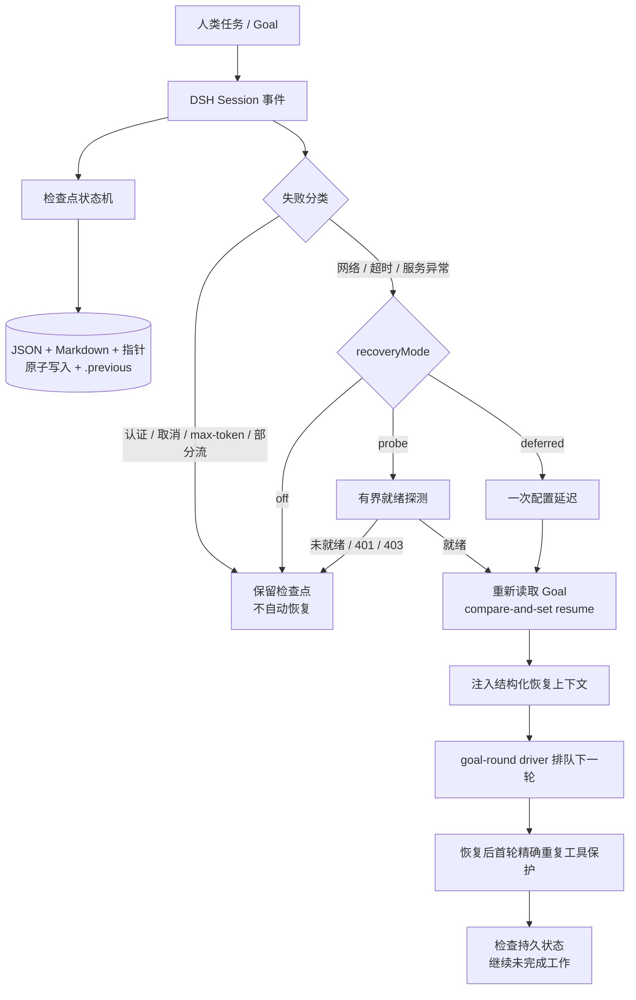

# dsh-task-checkpoint-guard

**为 DeepSeek Harness Agent 提供持久任务检查点与有界、安全的任务恢复能力。**

[English](README.md) | 简体中文 | [GitHub 仓库](https://github.com/jlnkx5200-beep/dsh-task-checkpoint-guard)

> **状态：v0.2.0 候选版本。** 已在 **DSH 0.2.1-rc.3**、Windows 11、Node.js 24.21.0 上开发和验证。`engines.dsh` 声明了可安装的版本范围，但其他版本尚未经过实测。可选记忆子系统**默认关闭**，不会改变 v0.1.0 的检查点/恢复行为。项目采用 [MIT License](LICENSE) 发布。

DSH 的长任务可能因网络中断、Provider 超时、5xx 服务异常或进程重启而中断。会话日志保留了对话历史，但恢复后的 Agent 仍需要一份紧凑、结构化的状态：原始目标、当前步骤、已经完成的工具调用、结果不确定的工具调用、Todo 列表，以及最近可见的执行结果。

`dsh-task-checkpoint-guard` 在本地保存这份状态，识别可恢复的传输层异常，并在完成有界就绪探测后，安全地重新激活已有的 DSH Goal。插件不会保存隐藏思维链，也不会把任务记录上传或远程同步到任何地方。

v0.2.0 增加了**可选的层级化记忆策展模块**：它可以区分 L0 目标与约束、L1 核心问题与概念、L2 先修知识和 L3 细节应用，维护概念依赖图，并在解释前注入有界的、考虑先修关系与学习状态的上下文。该功能默认 `memoryEnabled: false`；关闭时不会注册任何记忆工具或提示词 section，v0.1.0 的检查点 Schema 与恢复行为保持不变。

## 核心能力

- 为每个活跃 DSH Session 保存结构化检查点：**JSON + Markdown + Session 指针**。
- 记录原始人类指令、Goal 目标/修订号、Todo、Turn/Step、工具调用生命周期和有界可见结果。
- 不保存模型 reasoning 原文，只记录 reasoning block 数量和字符数。
- 在落盘前脱敏常见凭据形态和敏感 JSON 字段。
- 使用同目录临时文件 + `fsync` + rename 原子写入，并保留 `<文件>.previous` 上一份有效副本。
- 识别 `NETWORK`、`TIMEOUT`、`SERVICE`、`AUTH_OR_REQUEST`、`ABORTED`、`UNKNOWN` 等失败类别。
- 默认采用 fail-closed 策略：
  - 用户取消、认证/请求错误、max-token 停止、部分流结束时不会自动恢复；
  - 存在没有持久化结果的工具调用时不会自动恢复；
  - 不盲目重试已完成或结果未知的工具调用。
- 支持三种恢复模式：
  - `off`：只保存检查点，默认值；
  - `probe`：先进行有界 HTTP(S) 就绪探测，再恢复 Goal；
  - `deferred`：显式启用后，仅等待配置的延迟，不进行外发探测。
- 使用 compare-and-set 修订号重新激活 active 且 disarmed 的 Goal，并注入一条结构化恢复上下文。
- 可选地在**恢复后的第一个 Turn** 内拒绝与已完成调用完全相同的工具调用，Turn 结束后自动解除。
- 当宿主提供公开的 `ctx.sessionQuery` 服务时，可弥补检查点与当前 Session 日志之间的缺失事件。

### 可选层级化记忆（v0.2.0）

显式启用后：

- 对真实人类消息进行确定性捕获，不在每个 Session 事件上额外调用模型。
- 将信息分为 L0/L1/L2/L3，并独立记录优先级、可行性和可信度。
- L0/L1 不被低层细节静默覆盖；用户修正保留历史，同层矛盾形成显式冲突记录。
- 维护有向概念图，支持多个先修节点、环路检测、未解决依赖、用户顺序和动态解释顺序。
- 实现 Concept Prerequisite Guard：未解释概念不能作为默认推理前提；只有用户明确证据才能把概念标记为 `VERIFIED`。
- 在字符/Token 预算内优先注入 L0/L1/L2，L3 仅在相关时进入；未注入细节可通过显式搜索读取。
- 在公开工具注册表可用时注册 `memory_capture`、`memory_search`、`concept_graph`、`concept_status`、`memory_update`、`memory_delete`。
- 记忆使用独立 Schema、独立文件与独立原子写入，不与检查点混合。

完整设计见 [docs/design-v0.2.0.md](docs/design-v0.2.0.md)，测试状态见 [docs/testing.md](docs/testing.md)。

## 明确不做什么

- **不保存、不重建隐藏思维链。** 恢复仅依赖可见消息、持久执行事实和结构化状态。
- **不上传、不同步检查点。** 唯一的外部网络请求是发往用户配置端点的可选就绪探测。
- **不保证工具调用幂等。** 精确重复保护只覆盖恢复后第一个 Turn 内完全相同 fingerprint 的调用；相同副作用但参数不同的调用仍需模型自行判断。
- **不自行启动模型轮次。** 自动继续需要 DSH Goal 服务**和** goal-round driver。没有 driver 时可以重新激活 Goal 并排队上下文，但不一定会有新的 Turn 开始。
- **记忆守卫不是对自由文本的 token 级拦截。** 它可以在状态转换层硬拒绝、在上下文层给出先修约束，并对已生成文本记录审计；但不能证明所有模型回答都会遵守。
- **不把模型推断升级为用户事实或 `VERIFIED`。**
- **不宣称已证明解释质量提升。** 确定性语义 fixture 与可选真实模型 pilot 是不同证据层级。
- **不宣称兼容所有 DSH 版本。** 详见[兼容性](#兼容性)。

## 工作原理



写入器和恢复流程按 Session 串行化。恢复前会重新检查 Agent 是否存活、是否 idle、收件箱是否有待处理输入、Goal 修订号、phase、activation 和轮次预算。如果人类在这期间发送消息，就绪等待会被中止，插件不会恢复。

完整事件与 API 说明见 [docs/architecture.md](docs/architecture.md)。

## 前置要求

- **Node.js：** `^22.19.0` 或 `>=24.0.0`。
- **DSH：** 以 [package.json](package.json) 的 `engines.dsh` 为准；本地实测 `0.2.1-rc.3`。
- 必需宿主服务：`agents`、`sessions`。
- 可选宿主能力：
  - `goals` + `goal-round-driver`：自动 Goal 继续；
  - `credentials`：需要认证的探测；
  - `sessionQuery`：补齐插件加载前或检查点之后缺失的会话事件；
  - `tools` + `systemPrompt`：v0.2.0 记忆工具与自动上下文注入所需；缺失时检查点/恢复仍可加载，记忆工具和自动注入降级为不可用。`memoryEnabled` 默认关闭。
- 无 npm 运行时依赖。

## 安装

在本仓库中构建发布 tarball：

```sh
npm pack
```

安装到实际使用的 DSH Profile：

```sh
dsh plugin --profile <profile> add ./dsh-task-checkpoint-guard-0.2.0.tgz
```

直接从源码目录安装：

```sh
dsh plugin --profile <profile> add ./dsh-task-checkpoint-guard
```

确认组合配置包含 Bundle 行：

```sh
dsh --profile <profile> --dump-config
```

正常启动该 Profile（标准 Web Profile 也可以使用 `dsh web`）：

```sh
dsh --profile <profile>
```

默认检查点目录是 `$DSH_HOME/task-checkpoints`；未设置 `DSH_HOME` 时为 `%USERPROFILE%\.dsh\task-checkpoints`。

### 验证

任务运行后检查本地文件：

```powershell
Get-ChildItem "$HOME\.dsh\task-checkpoints" -Recurse
Get-Content "$HOME\.dsh\task-checkpoints\tasks\<task-id>.md"
```

POSIX Shell：

```sh
find "${DSH_HOME:-$HOME/.dsh}/task-checkpoints" -maxdepth 3 -type f
```

### 卸载

```sh
dsh plugin --profile <profile> remove dsh-task-checkpoint-guard
```

卸载插件不会删除检查点。只有确认不再需要这些记录时，才应手动删除检查点目录。

## 配置

Bundle 默认值较保守：`recoveryMode: off`，本地检查点开启，精确重复工具保护只在恢复后的 Turn 生效。要覆盖 Bundle 行，请编辑 Profile 的 `cordis.patch.yml`，并完整重述需要的配置（后层 Patch 会替换整行 config）：

```yaml
- id: task-checkpoint-guard
  name: dsh-task-checkpoint-guard
  config:
    checkpointRoot: ~/.dsh/task-checkpoints
    recoveryMode: probe
    probeUrl: https://api.example.test/v1/models
    probeMethod: GET
    probeAuth: bearer
    credentialRef: EXAMPLE_API_KEY
    probeExpectedStatuses: [200]
    probeTimeoutMs: 5000
    maxProbeAttempts: 5
    initialProbeDelayMs: 1000
    maxProbeDelayMs: 30000
    jitterRatio: 0.2
    maxAutoResumes: 3
    providerFilter: null
    duplicateToolPolicy: deny-on-recovery
    maxToolHistory: 80
    maxToolResultChars: 2000
    maxToolArgumentChars: 1000
    maxRecoveryContextChars: 16000
    persistDebounceMs: 100
    reconstructFromSessionQuery: true
    memoryEnabled: false
    memoryScopeId: default-user
    maxMemoryRecords: 500
    maxMemoryConcepts: 300
    maxMemoryHistoryVersions: 20
    maxMemoryAuditEntries: 200
    maxMemoryRecordChars: 2000
    maxMemoryContextChars: 6000
    maxMemoryContextTokens: 1200
```

`https://api.example.test` 与 `EXAMPLE_API_KEY` 都是占位符。请使用与你的部署匹配的就绪端点和凭据引用。凭据引用指向 DSH credentials 服务中的秘密；其值不会写入检查点。

完整参数、类型、范围和安全性说明见 [docs/configuration.md](docs/configuration.md)。

### 可选层级化记忆示例

```yaml
- id: task-checkpoint-guard
  name: dsh-task-checkpoint-guard
  config:
    recoveryMode: off
    memoryEnabled: true
    memoryRoot: ~/.dsh/task-memory
    memoryScopeId: default-user
    maxMemoryRecords: 500
    maxMemoryConcepts: 300
    maxMemoryContextChars: 6000
    maxMemoryContextTokens: 1200
```

`memoryEnabled: false` 时设置 `memoryRoot` 会被配置校验拒绝，而不是静默忽略。记忆文件与检查点文件相互独立，v0.1.0 恢复不依赖记忆文件。

### 最小安全示例

只保存检查点：

```yaml
- id: task-checkpoint-guard
  name: dsh-task-checkpoint-guard
  config:
    recoveryMode: off
```

使用就绪探测自动恢复：

```yaml
- id: task-checkpoint-guard
  name: dsh-task-checkpoint-guard
  config:
    recoveryMode: probe
    probeUrl: https://your-provider.example/v1/models
    probeAuth: bearer
    credentialRef: YOUR_PROVIDER_API_KEY
    providerFilter: your-provider
    duplicateToolPolicy: deny-on-recovery
```

显式启用延迟恢复（不先证明网络可达）：

```yaml
- id: task-checkpoint-guard
  name: dsh-task-checkpoint-guard
  config:
    recoveryMode: deferred
    initialProbeDelayMs: 5000
    maxAutoResumes: 1
```

## 使用演示：无破坏性的多阶段任务

以下示例只使用临时目录，不会修改项目或系统设置。

1. 在一个临时目录启动 DSH Session。
2. 给 Agent 一个 Goal，例如：

   ```text
   创建 ./checkpoint-demo/stages/a.txt，然后创建 ./checkpoint-demo/stages/b.txt。
   验证两个文件并总结内容。不要修改 ./checkpoint-demo 之外的任何内容。
   ```

3. Agent 可能调用 `todo_write`、创建目录并写入文件。每个 Turn/工具事件都会更新 `$DSH_HOME/task-checkpoints`。
4. 打开 Markdown 检查点，可以看到原始目标、Goal 修订号、Todo、当前步骤、已完成工具、最近可见结果和恢复策略。**看不到 reasoning 原文。**
5. 如需安全演练恢复，请使用一次性的 DSH Profile 和本机 loopback 探测端点；不要故意破坏正常 Provider 凭据或网络。
6. 恢复后注入的上下文会告诉模型哪些工具已完成、哪些结果未知、哪些 Todo 尚未完成。`duplicateToolPolicy: deny-on-recovery` 时，恢复后首轮会拒绝完全相同的已完成工具调用。

更多排障见 [docs/troubleshooting.md](docs/troubleshooting.md)。

## 隐私与安全

- 检查点仅保存在本地，包含任务文本、有界工具参数/结果和 Session 标识。请把检查点目录视为敏感用户数据。
- 可选记忆文档同样仅保存在本地，可能包含用户目标、问题、概念、修正历史与来源引用；请按会话历史的敏感级别保护 `memoryRoot`。
- 凭据按探测次数实时从 DSH credentials 服务解析，只作为 `Authorization` Header 发往配置的探测端点，不会写入状态或日志。
- 探测拒绝重定向；Bearer 探测必须使用 HTTPS，除非目标是 loopback。
- 常见秘密形态和敏感 JSON Key 会在落盘前脱敏。脱敏是纵深防御，不是对任意用户文本的绝对保证。不要把秘密写进任务提示或工具参数。
- 检查点文件请求 `0600` 权限；Windows 上实际访问控制由目录 ACL 决定，请保护 `$DSH_HOME`。
- 不支持多个进程同时写同一个检查点目录。
- 威胁模型与漏洞报告方式见 [SECURITY.md](SECURITY.md)。

## 兼容性

| 接口/环境 | 状态 |
|---|---|
| DSH `0.2.1-rc.3` | 已本地验证：Cordis Loader Smoke、公开 API 集成测试、真实 `ToolRuntime` Schema 注册与执行、干净 Profile 安装/卸载 Smoke |
| `engines.dsh` 范围内的其他 DSH 版本 | 可安装，但**未实测** |
| 层级化记忆 | 确定性测试 A–K 与语义 fixture 通过；真实模型 pilot Harness 已提供，但尚未建立真实模型效果提升结论 |
| Windows 11 + Node.js 24.21.0 | 已本地验证 |
| Node.js 22.19 / 其他操作系统 | 已配置 CI 矩阵，但尚未声明为本地实测通过 |
| DSH 私有 API / 其他插件私有源码 | 未使用，见 [docs/architecture.md](docs/architecture.md#public-api-dependencies) |

自动继续还要求宿主同时加载 `@deepseek-ai/dsh-goal` 与 `@deepseek-ai/dsh-goal-round-driver`。没有 driver 时，检查点和上下文注入仍可用，但不一定会自动开始下一轮。

## 故障排查

常见情况：

- **没有检查点文件：** 确认 Profile 中包含 Bundle 行、插件成功加载；检查 `checkpointRoot` 和权限。
- **没有自动恢复：** 默认模式是 `off`；检查 `recoveryMode`、`probeUrl`、Goal phase/activation 以及是否有 pending 工具调用。
- **探测返回 401/403：** 网络可达但凭据被拒绝或无法解析；插件会有意停止。
- **工具调用被拒绝：** 该调用与恢复前已完成或结果未知的调用完全一致。请使用已记录结果，或换一个检查操作先验证真实状态。
- **检查点损坏：** Loader 会尝试 `<file>.previous`，再尝试扫描 task 文件；请保留目录以便诊断。

完整说明：[docs/troubleshooting.md](docs/troubleshooting.md)。

## 路线图

以下均为**计划功能，尚未实现**：

- 不硬编码 Provider 的更多就绪探测预设。
- 多 Agent/子 Agent 任务树与父子检查点关联。
- 可视化检查点浏览与恢复界面。
- 更完善的持久化失败和压缩边界恢复策略。
- 检查点保留数量、清理命令和静态加密。
- 多 DSH 版本的正式兼容性矩阵。
- 由工具定义提供的更精确幂等性元数据。
- 多轮、盲评的统计级真实模型语义基准。
- 跨进程记忆锁与可选静态加密。
- 基于已验证外部知识源的概念关系推断，永远不以关键词共现替代明确依赖。

## 开发

```sh
npm test
npm run check
npm run pack:check
npm run test:semantic:dry-run
```

真实模型语义 pilot 需要公开 `DSH_EVAL_*` API 凭据，且不会在插件启动或 Session 事件中自动运行。评分标准与结论边界见 [docs/semantic-acceptance.md](docs/semantic-acceptance.md)。

运行可选的真实 Loader Smoke：

```powershell
$env:DSH_CHECKOUT = (Resolve-Path '..\deepseek-harness').Path
npm test
```

见 [CONTRIBUTING.md](CONTRIBUTING.md)。

## 许可证

本项目采用 **MIT License**，Copyright (c) 2026 jlnkx5200-beep。完整文本见 [LICENSE](LICENSE)。
