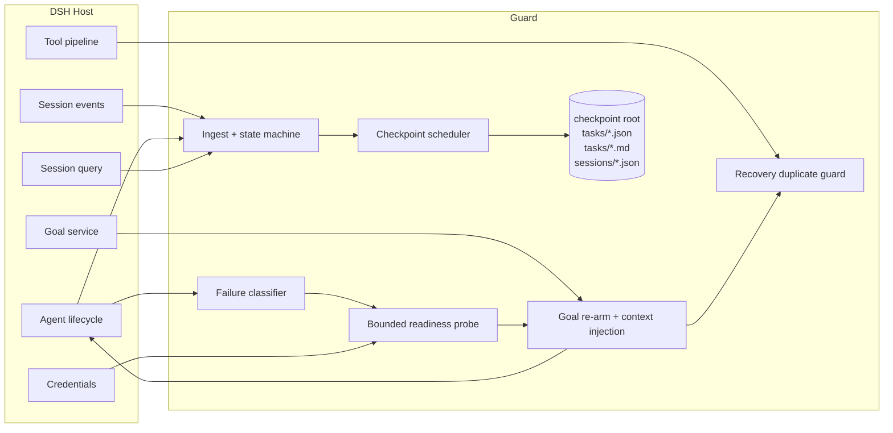
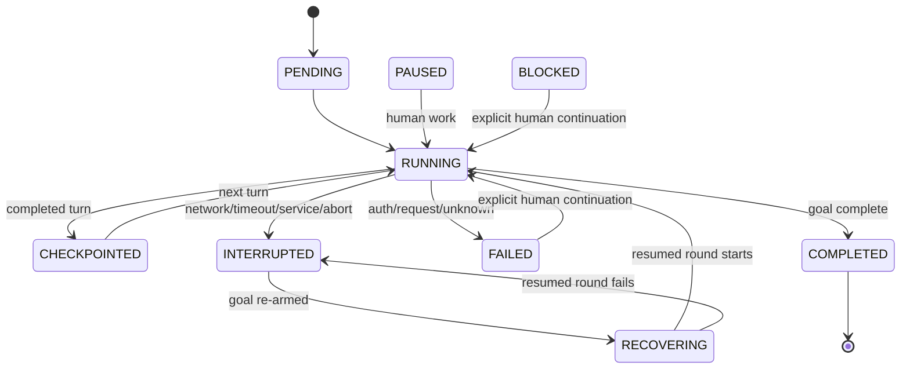
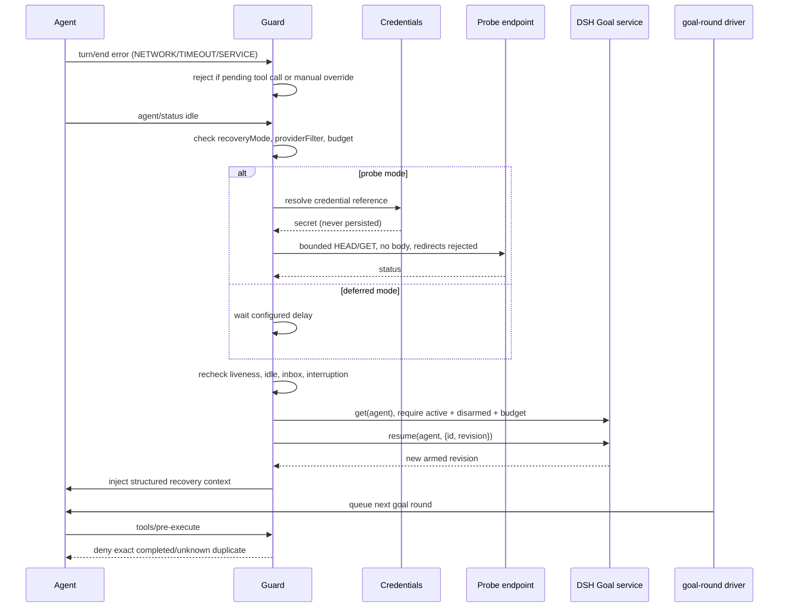

# Architecture

## Goals and non-goals

The checkpoint guard exists to make a long DSH task resumable after a transport or service interruption. It persists the **minimum structured facts** needed to re-establish context:

- who the task belongs to (session/task/goal identity, provider/model);
- what the human asked for;
- where the agent was in the turn/step sequence;
- which tools completed, failed, or have an unknown outcome;
- the current todo list and bounded visible results;
- why the task stopped and what recovery policy was attempted.

It does not attempt to serialize the model's hidden reasoning or the full provider request. It does not own DSH's persistence layer, and it is not an independent evaluator of task completion.

## Runtime topology



## Event ingestion

The plugin listens to documented public events and reduces them into one state record per live session.

| Event | State effect |
|---|---|
| `session/event` `user/message` | Captures the first genuine human instruction (`source.kind === "user"`); a later human message cancels automatic recovery. |
| `session/event` `goal/change` | Adopts goal id/revision/objective/phase and resets task-scoped state when the goal changes or is cleared. |
| `session/event` `request/header` | Captures provider, model, and reasoning effort. |
| `session/event` `model/selection` | Captures an explicit route change. |
| `session/event` `todo/write` | Stores the bounded whole todo list. |
| `session/event` `turn/start`, `step/start`, `step/end`, `turn/end` | Advances the execution state machine; `turn/end` classifies failures. |
| `session/event` `assistant/message` | Stores visible text and reasoning counts only; excludes reasoning/image content. |
| `session/event` `tool/call` | Stores a bounded redacted argument preview and a canonical argument fingerprint. |
| `session/event` `tool/result` | Settles the matching call and marks `TOOL_OUTCOME_UNKNOWN` specially. |
| `session/event` `llm/retry` | Stores bounded retry facts. |
| `agent/error` | Records failures that may not have a durable turn event body. |
| `agent/status` idle | Offers recovery after the agent reaches quiescence. |
| `agent/created` | Hydrates a checkpoint before the resumed agent starts work. |
| `agent/disposed` | Flushes and releases per-session state. |
| `tools/pre-execute` | Enforces the exact-duplicate guard during a resumed turn. |

Events are processed through a per-session promise chain so two events from the same session cannot ingest out of order.

## State machine



The durable status is a convenience projection, not a replacement for the DSH Session log. Recovery eligibility is tracked separately in `recovery` and `interruption` so a status transition alone cannot cause an unsafe retry.

## Automatic recovery sequence



### Race fences

Before resuming, the guard checks all of the following:

1. Plugin has not been disposed.
2. The exact agent object is still registered (`ctx.agents.get(id) === agent`).
3. Agent status is `idle`.
4. Neither `inbox.nextTurn` nor `inbox.nextStep` contains pending input.
5. Interruption is still marked auto-resume eligible.
6. Recovery has not already been attempted to its configured limit.
7. Provider filter, when configured, matches the recorded route.
8. Goal is active, not complete/paused/blocked, disarmed, and under its round budget.
9. Human input or a new turn has not aborted the in-flight readiness wait.
10. `agent.inject()` exists before the goal is re-armed.

If injection fails after re-arm, the guard calls `ctx.goals.disarm(agent)` as a best-effort rollback. The goal remains durable at its new revision but continuation is disarmed.

## Atomic persistence

Each checkpoint consists of three files under the configured root:

```text
<root>/
├── tasks/
│   ├── <safe-task-id>.json
│   ├── <safe-task-id>.json.previous
│   ├── <safe-task-id>.md
│   └── <safe-task-id>.md.previous
└── sessions/
    ├── <safe-session-id>.json
    └── <safe-session-id>.json.previous
```

The JSON task document is authoritative. The Markdown file is for human inspection. The session pointer stores **relative** `tasks/...` paths, so a published sample cannot leak an absolute local root.

### Atomic write algorithm

1. Serialize the checkpoint snapshot.
2. Create the destination directory with owner-only mode where the platform supports it.
3. If the old target is valid, write it to a same-directory temporary file, `fsync`, and replace `<target>.previous` with it.
4. Write the new content to a same-directory temporary file, `fsync`, and rename it over the target.
5. On Windows, if rename-over-existing is refused, park the old target, publish the new file, and restore on failure.
6. Best-effort `fsync` the containing directory.

The previous copy is only replaced when the old target passed the document-specific validator. A corrupt target therefore does not destroy the last valid backup.

### Loader fallback

`loadCheckpoint()` tries, in order:

1. session pointer target;
2. session pointer `.previous`;
3. a scan of `tasks/*.json` for the most recently updated matching `sessionId`, when the pointer is missing or unusable.

For the chosen task, it tries the task target and then the task `.previous`. Every loaded document is validated and normalized by `normalizeLoadedState()`; unknown schema versions are rejected rather than guessed.

### Concurrency

- Writers are serialized in-process by a per-target lock and a per-task/session checkpoint lock.
- Event ingestion is serialized per session.
- The checkpoint write scheduler coalesces bursts under a configurable debounce, while tool calls/results and turn boundaries are flushed immediately.
- Cross-process writers are **not supported**. Running two DSH processes against the same checkpoint root for the same session may cause last-writer-wins behavior.

## Session history reconciliation

A plugin can mount after a session already started, and a crash may occur between two durable checkpoint writes. When `ctx.sessionQuery` is available and `reconstructFromSessionQuery` is enabled, the guard calls the public `ctx.sessionQuery.readSession(session.id)` path and replays events newer than the checkpoint's `lastEventSeq`. This is a read-only operation against DSH's live-preferred session query service.

If `sessionQuery` is absent, the plugin proceeds with the checkpoint and future events. It does not call the deprecated `session.snapshotEvents()` API in production.

## Public API dependencies

This table is part of the compatibility contract. None of these are private sibling-package imports.

| API | Classification | Required? | Use |
|---|---|---|---|
| `ctx.agents.get/list` | Public documented core service | yes | exact-agent liveness and mount enumeration |
| `ctx.sessions` (injection only) | Public documented core service | yes | required host service availability |
| `session/event` event | Public documented durable event feed | yes | state ingestion |
| `agent/created`, `agent/error`, `agent/status`, `agent/disposed` | Public documented agent events | yes | lifecycle |
| `agent.inject(UserMessage)` | Public documented agent method | for auto recovery | inject structured context |
| `agent.inbox.nextTurn/nextStep` | Public documented inbox fields | for race safety | detect pending human work |
| `ctx.get('goals').get/resume/disarm` | Public documented goal service | optional | reactivate active goal |
| `ctx.get('credentials').resolve` | Public documented credential seam | optional | authenticated readiness probes |
| `ctx.get('sessionQuery').readSession` | Public documented query service | optional | reconcile missing history |
| `ctx.get('dshHomePath')` | Public host-provided path service | optional | default checkpoint root |
| `tools/pre-execute` event | Public documented tool waterfall | optional at runtime | recovery duplicate guard |
| `ctx.logger`, `ctx.effect`, `ctx.on` | Public Cordis host API | yes | lifecycle/logging |

Not used:

- no direct imports from `@deepseek-ai/dsh-*` packages;
- no imports from another plugin's `src/` or private files;
- no `snapshotEvents()` production calls;
- no private patch files or hardcoded host/provider endpoints;
- no hardcoded credentials or profile paths.

## Checkpoint schema

`schemaVersion` is `1`. The JSON contains:

- session/task/goal identity and provider/model;
- original/last human instruction;
- status and bounded transition history;
- goal snapshot (objective, revision, phase, rounds);
- todos;
- execution turn/step/history;
- bounded confirmed visible results;
- bounded tool records with `argumentsPreview` and `argumentsHash`;
- pending/unknown tool call facts;
- interruption and recovery facts;
- explicit `rawReasoningPolicy` and `storageNotice` fields.

Unknown or future schema versions are rejected and the loader falls back to `.previous`; it does not migrate silently.

## Failure classification

The classifier is intentionally conservative:

- `NETWORK`, `TIMEOUT`, and `SERVICE` may be auto-resumed if no tool is pending.
- `AUTH_OR_REQUEST`, `ABORTED`, `MAX_TOKENS`, `STREAM_PARTIAL`, and `UNKNOWN` never auto-resume.
- A pending tool call makes auto-resume ineligible even for a transport error.
- A synthetic `TOOL_OUTCOME_UNKNOWN` result is recorded as an uncertain outcome; it is shown in recovery context but does not by itself block recovery, because DSH guarantees a durable result exists.

## Privacy boundary

Data flows only:

- Session events → in-memory state → local atomic files;
- configured probe URL → bounded HEAD/GET → status/error facts in state;
- recovery state → one user-role context message injected into the same agent.

No checkpoint data is sent to a remote service. No API key value is passed into checkpoint documents. Secret-shaped strings are redacted before truncation. Absolute checkpoint roots are not stored in session pointers.
